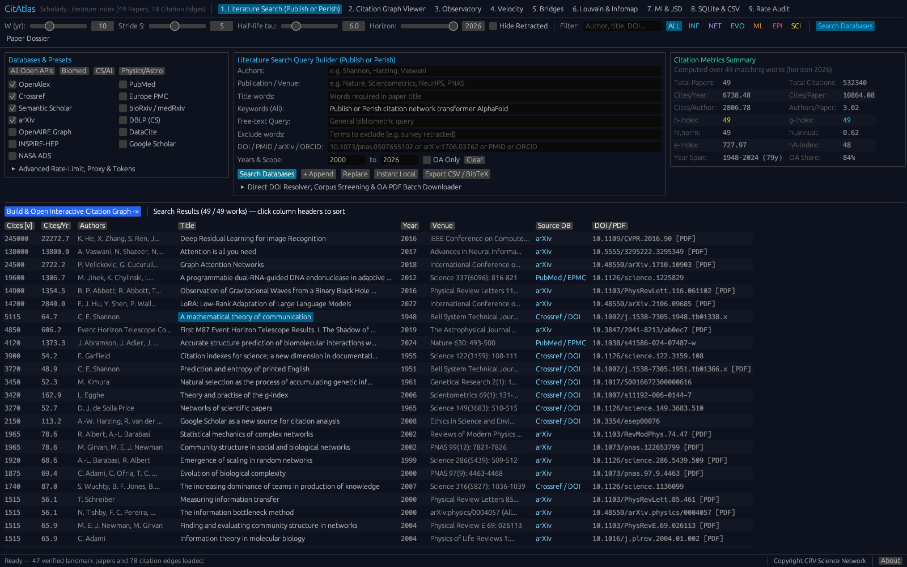

# CitAtlas (`cit-atlas` v1.8.0)



Native safe-Rust (`#![forbid(unsafe_code)]` library / `#![deny(unsafe_code)]` binary) desktop (`eframe`/`egui` 0.31 + `wgpu` 24.0 WGSL compute/instanced renderer) and `clap` CLI scientometrics workstation.

## Core Capabilities & Scientific Summary

- **13-Provider Scholarly Search & Citation Graph Harvester (`src/search_providers.rs`, `src/crawler.rs`)**:
  - REST and citation-graph ingestion across OpenAIRE Graph v2/v3 + ScholExplorer v3, INSPIRE-HEP, NASA ADS, OpenAlex, Semantic Scholar, Crossref, arXiv, DataCite, PubMed E-Utilities, Europe PMC, DBLP, bioRxiv/medRxiv, and `robots.txt`-gated Google Scholar SERP parsing, with multi-key DOI/arXiv/OpenAlex/S2/title deduplication and SQLite `LedgerStore` persistence.
- **24-Domain Configurable Token-Bucket Rate Limiter & Audit Log (`src/rate_limiter.rs`)**:
  - Thread-safe per-domain token buckets (`refill_rps`, `burst_capacity`, `min_spacing_ms`, `jitter_ms`, RFC 9110 `Retry-After` circuit-breaker cooldowns, and live `CrawlAuditOutcome` telemetry).
- **Parallel Scientometrics & Community Detection (`src/analytics.rs`, `src/community_detection.rs`)**:
  - Exact Brandes (2001) vertex/edge betweenness for $n \le 1{,}500$ and Horvitz–Thompson stratified pivot Brandes for $n > 1{,}500$ (top-64 hub pivots weighted by $1.0$; remaining uniform non-hub pivots weighted by $(n - H)/(K - H)$).
  - Multi-level Louvain modularity $Q(\gamma)$ and two-level Rosvall–Bergstrom Infomap flow compression $L(M)$ using directed forward edges ($1.0$) and reverse `in_adj` back-flow ($0.25$).
  - Ke et al. (2015) Sleeping Beauty coefficient $B$ & awakening year $t_a$ (excluding pre-publication citations $c_{\text{yr}} < t_{\text{pub}}$), exact unclamped Burt (1992) structural constraint $C_i$, Guimerà–Amaral $(z_i, P_i)$ cartography, all-time/5-year Disruption Index ($CD, CD_5$), DAG HITS hub/authority, sliding-window $I_w(D; T)$ / NMI / PMI / Jensen–Shannon divergence drift, and Publish-or-Perish (`h`, `g`, `hc`, `hI,norm`, `hA`) metrics.
- **`wgpu` WGSL 50,000+ Node Network Renderer & Bio/DataCite Bridges (`src/wgpu_graph.rs`, `src/bio_entity_bridges.rs`, `src/export.rs`)**:
  - 3-pass WGSL compute ForceAtlas2 (`cs_clear_grids`, `cs_bin_nodes`, `cs_forces_and_integrate` with disjoint aligned $3 \times 3$ fine supercell neighborhood and $|\Delta s| > 1$ multipole far-field), uniform `min(viewport_w, viewport_h)` isotropic projection, per-edge `raw_eb` thickness in `fs_edge`, curved Bézier tangent arrowheads clipped outside target node radii, Retraction Watch screening, UniProt/PDB/EPMC bio-entity bridges, GraphML 1.0, Gephi GEXF 1.3, SVG, BibTeX, JSON, and 10 RFC 4180 CSV tables.

## Controls & Keyboard Hotkeys (GUI)

| Shortcut / Control | Action | Scope / Notes |
| --- | --- | --- |
| `1` – `9` | Switch workbench tabs 1–9 | Guarded by `!ctx.wants_keyboard_input()` |
| `Space` | Toggle ForceAtlas2 live physics simulation | Guarded by `!ctx.wants_keyboard_input()` |
| `0` or `R` | Fit camera to active graph bounding box | Guarded by `!ctx.wants_keyboard_input()` |
| `Ctrl+F` / `Cmd+F` | Focus global `Filter:` text search bar | Global top ribbon |
| `F1` | Toggle About CitAtlas window | Global |
| `Escape` | Dismiss About window, then Paper Dossier drawer | Global |
| Mouse Wheel | Cursor-centered smooth zoom (`0.18x` – `12.0x`) | Tab 2 Graph Viewport |
| Left Drag (node / canvas) | Drag individual node (pinned) or pan camera | Tab 2 Graph Viewport |
| Left Click (node / bridge) | Open Paper, DataCite, or Bio-Entity Dossier | Tab 2 Graph Viewport |
| `W`, `Stride S`, `Half-life tau`, `Horizon` | Adjust temporal analytics parameters | Debounced on slider `drag_stopped()` / `lost_focus()` |
| `Reset Filters` (empty-state button) | Restore default `Horizon`, retracted visibility, and filters | Shown when active `n == 0` |

## CLI Subcommands & Flags

| Command | Purpose | Key Flags |
| --- | --- | --- |
| `cit-atlas` / `gui` | Launch interactive 9-tab desktop GUI | `--screenshot <PNG>`, `--screenshot-view <1\|2\|3>` |
| `search <QUERY>` | Query scholarly APIs & export graphs/tables | `--providers`, `--limit`, `--oa-only`, `--year-min`, `--year-max`, `--snowball-hops`, `--rw-csv`, `--screen-integrity`, `--openaire-token`, `--ads-token`, `--email`, `--db`, `--download-dir`, `--export-csv`, `--export-csv-dir`, `--export-graphml`, `--export-gexf`, `--export-json` |
| `crawl [QUERY]` | Polite robots-gated SERP & metadata crawl | `--targets`, `--pages`, `--limit`, `--pace-ms`, `--cites-id`, `--local-html`, `--proxy`, `--ignore-robots`, `--hydrate-edges`, `--no-self-citations`, `--db`, `--export-csv-dir` |
| `screen` | Screen corpus for retractions & bio/DataCite links | `--from-db`, `--from-file`, `--rw-csv`, `--crossref`, `--datacite`, `--epmc-annotations`, `--uniprot-pdb`, `--link-shared-artifacts`, `--save-db`, `--export-csv-dir` |
| `export-graph` | Export GraphML 1.0 / Gephi GEXF 1.3 networks | `--from-db`, `--from-file`, `--format`, `--layout`, `--color-by`, `--include-datacite-nodes`, `--exclude-retracted`, `--out-dir`, `--out-file` |
| `export-csv` | Export 1 or all 10 RFC 4180 CSV tables | `--from-db`, `--from-file`, `--exclude-retracted`, `--table`, `--out-dir`, `--out-file` |
| `download` | Batch-download Open-Access PDFs | `--doi`, `--from-db`, `--from-file`, `--out-dir`, `--email`, `--pace-ms` |
| `analyze` | Compute headless scientometrics & drift | `--from-db`, `--from-file`, `--window`, `--stride`, `--half-life`, `--horizon`, `--exclude-retracted`, `--export-csv`, `--export-csv-dir`, `--export-graphml`, `--export-gexf`, `--export-json`, `--export-svg` |
| `communities` | Run Louvain $Q(\gamma)$ & Infomap $L(M)$ | `--from-db`, `--from-file`, `--resolution`, `--teleport`, `--export-csv`, `--export-graphml`, `--export-gexf`, `--export-json` |
| `rate-limits` | Configure 24-domain buckets & simulate bursts | `--rate-scale`, `--set`, `--simulate-burst`, `--from-db`, `--save-db`, `--export-audit-csv`, `--export-policies-csv` |
| `benchmark` | Generate synthetic citation network (30–150k) | `--nodes`, `--seed`, `--bridge-beta`, `--regime`, `--export-csv-dir`, `--export-graphml`, `--export-gexf`, `--export-json` |

## Quick Start & Headless Validation

```bash
cargo test --all-targets
cargo run --release
cargo run --release -- search "quantum mutual information" --providers openaire,inspire,ads --export-csv-dir ./cit_atlas_csv
cargo run --release -- rate-limits --simulate-burst --export-policies-csv ./domain_rate_policies.csv --export-audit-csv ./crawl_telemetry_audit.csv
cargo test --test headless_validation -- --nocapture
```

Observed offline validation telemetry ([`validation/cit_atlas_validation_summary.json`](validation/cit_atlas_validation_summary.json)):
- **T1 (24-Domain Concurrent Token Bucket)**: 128 concurrent permits across 8 threads (OpenAlex, Crossref, PubMed, Semantic Scholar), `0` `min_spacing_ms` violations, `0` unexpected `CircuitOpen` rejections, RFC 9110 `HTTP 429 Retry-After` circuit-breaker verified.
- **T2 (47-Paper Empirical Citation DAG)**: 78 directed edges (19 cross-disciplinary), Louvain modularity $Q = 0.6612$ across 5 communities, Infomap $L(M) = 4.2956$ bits ($19.52\%$ compression) across 7 modules, exact PageRank flow sum `1.0`, corpus $h = 4$, mean $CD = 0.3897$.
- **T3 (Deduplication & Roundtrips)**: 7 raw records $\rightarrow$ 4 deduplicated works ($P = 1.0, R = 1.0, F_1 = 1.0$), exact roundtrips verified across BibTeX, GraphML 1.0, GEXF 1.3, RFC 4180 CSV, and SQLite `LedgerStore`.

## Documentation & Preprint

- [`docs/USER_GUIDE.md`](docs/USER_GUIDE.md) — End-user manual covering all 9 workbench tabs, GPU graph controls, CLI pipelines, and export formats.
- [`docs/SCIENTIFIC_METHODS.md`](docs/SCIENTIFIC_METHODS.md) — Formal mathematical specification of Horvitz–Thompson Brandes, directed Infomap back-flow, Ke Sleeping Beauty $B$, Burt $C_i$, Disruption $CD$, and WGSL physics/rendering.
- **CRV Science Apps Hub**: <https://crvscience.com/apps>
- **Preprint (`APP-PREPRINT-05`)**: [Cit-Atlas: Rate-Limited Multi-Provider Bibliometric Graph Harvesting, Louvain Community Detection, and Scientometric Analytics](https://crvscience.com/apps/preprints/cit-atlas-bibliometric-graph-engine)
- **Concept DOI**: [`10.5281/zenodo.24222380`](https://doi.org/10.5281/zenodo.24222380)

See [`CITATION.cff`](CITATION.cff) for machine-readable citation metadata.
